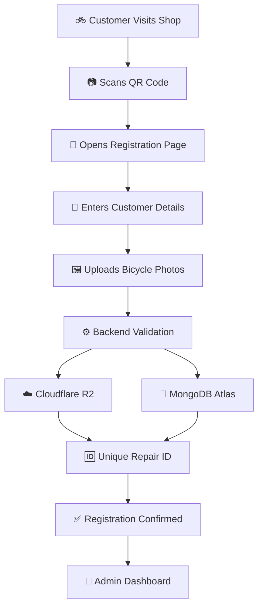
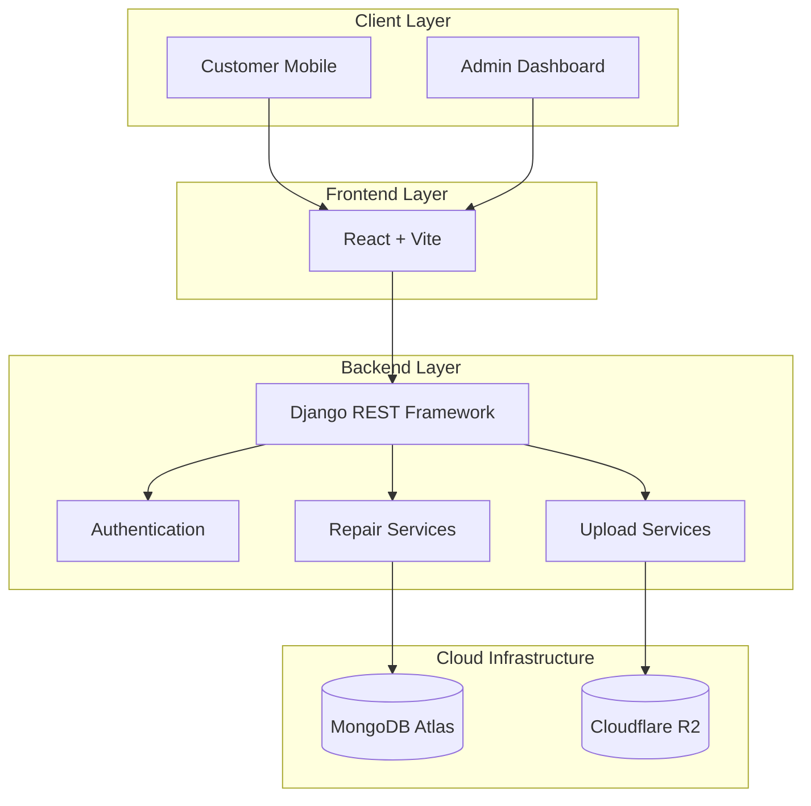

<div align="center">

# 🚲 CycleCare

### Your Cycle, Our Care.

**A Smarter Way to Manage Bicycle Repairs.**

<p>
  
  
  
</p>

<p>
  A modern, QR-powered bicycle repair management platform
  built to transform traditional repair shops into digitally
  organized businesses.
</p>

**Built for Rajput Auto Garage**

</div>

---

## 🌟 Overview

**CycleCare** is a lightweight digital bicycle repair management system designed to replace traditional paper-based repair registers.

Instead of manually writing customer information in notebooks, customers can simply scan a QR code, submit their details, upload bicycle photos, and describe their repair requirements.

The shop owner can manage all customer records through a secure, responsive admin dashboard.

> From Paper Registers to Smart Repairs. 🚲

## ✨ Key Features

<table>
<tr>
<td width="50%">

### 📱 QR-Based Registration
- Scan and register instantly.
- No app installation required.
- No customer account required.
- Simple mobile-friendly form.

</td>
<td width="50%">

### 🛠️ Digital Repair Records
- Unique Repair ID generation.
- Customer information management.
- Repair problem descriptions.
- Historical repair records.

</td>
</tr>
<tr>
<td width="50%">

### 🖼️ Cloud Photo Storage
- Upload bicycle photographs.
- Secure Cloudflare R2 storage.
- Signed image URLs.
- Automatic 30-day photo expiration.

</td>
<td width="50%">

### 🔐 Admin Dashboard
- Secure administrator login.
- Search by name, phone or Repair ID.
- View complete repair information.
- Direct customer calling.
- Manual record creation.

</td>
</tr>
</table>

### ⚡ Additional Capabilities

- 📂 Archive old repair records.
- 🔎 Quickly retrieve customer information.
- 📱 Responsive across mobile, tablet and desktop.
- 🔒 Backend-side validation and authentication.
- 🧹 Automatic photo retention management.

---

## 🔄 How CycleCare Works



## 🧰 Technology Stack

<div align="center">

### Frontend


### Backend


### Database & Storage


### Tools & Deployment


</div>

| Technology | Purpose |
|---|---|
| React.js + Vite | Frontend application |
| Tailwind CSS | Responsive UI |
| Framer Motion | UI animations |
| GSAP | Advanced animations |
| Django REST Framework | Backend APIs |
| PyMongo | MongoDB connectivity |
| MongoDB Atlas | Database |
| Cloudflare R2 | Image storage |
| Vercel | Frontend deployment |
| Render | Backend deployment |

---

## 🏗️ System Architecture



---

## 📂 Project Structure

```text
CycleCare/
│
├── frontend/
│   ├── public/
│   └── src/
│       ├── assets/
│       ├── components/
│       │   ├── common/
│       │   ├── layout/
│       │   ├── preloader/
│       │   └── ui/
│       ├── pages/
│       │   ├── CustomerRegistration/
│       │   ├── Confirmation/
│       │   ├── AdminLogin/
│       │   └── Dashboard/
│       ├── services/
│       ├── hooks/
│       ├── context/
│       ├── routes/
│       ├── App.jsx
│       └── main.jsx
│
├── backend/
│   ├── config/
│   ├── apps/
│   │   ├── authentication/
│   │   ├── repairs/
│   │   └── uploads/
│   ├── services/
│   │   ├── mongodb.py
│   │   ├── cloudflare_r2.py
│   │   └── repair_id.py
│   ├── requirements.txt
│   └── manage.py
│
├── README.md
└── .gitignore
```

---

## 🆔 Unique Repair ID System

Every repair registration receives a unique identifier.

Example:

```text
CC-2026-00001
CC-2026-00002
CC-2026-00003
```

Repair IDs are generated by the backend and stored in MongoDB.

They can be used to search and retrieve customer repair records.

---

## ☁️ Smart Photo Retention

CycleCare uses Cloudflare R2 for secure bicycle photo storage.

**30-Day Photo Retention Policy**

| Data | Retention |
|---|---|
| Customer Name | Permanent |
| Mobile Number | Permanent |
| Repair Description | Permanent |
| Repair ID | Permanent |
| Registration Date | Permanent |
| Bicycle Photos | 30 Days |

After the retention period, photographs are automatically deleted through R2 lifecycle rules, while customer and repair records remain accessible.

---

## 🔌 API Overview

| Method | Endpoint | Description |
|---|---|---|
| POST | `/api/auth/login/` | Admin Login |
| POST | `/api/auth/logout/` | Admin Logout |
| GET | `/api/auth/me/` | Admin Information |
| POST | `/api/repairs/` | Customer Registration |
| GET | `/api/repairs/` | Fetch Repair Records |
| GET | `/api/repairs/:id/` | Repair Details |
| POST | `/api/repairs/manual/` | Manual Registration |
| PATCH | `/api/repairs/:id/archive/` | Archive Record |
| POST | `/api/uploads/presign/` | Secure Upload URL |

---

## 🚀 Getting Started

### 1. Clone Repository

```bash
git clone https://github.com/YOUR_USERNAME/YOUR_REPOSITORY.git

cd CycleCare
```

### 2. Frontend Setup

```bash
cd frontend

npm install

npm run dev
```

### 3. Backend Setup

```bash
cd backend

python -m venv venv
```

Activate virtual environment:

**Windows:**

```powershell
venv\Scripts\activate
```

Install dependencies:

```bash
pip install -r requirements.txt
```

Run Django server:

```bash
python manage.py runserver
```

### 4. Environment Configuration

Create a `.env` file inside the backend directory.

```env
DEBUG=False
SECRET_KEY=your_secret_key
ALLOWED_HOSTS=

MONGODB_URI=
MONGODB_DATABASE=

R2_ACCOUNT_ID=
R2_ACCESS_KEY_ID=
R2_SECRET_ACCESS_KEY=
R2_BUCKET_NAME=
R2_ENDPOINT_URL=

FRONTEND_URL=
```

**Important:** Never commit production credentials or `.env` files to GitHub.

---

## 🔐 Security

CycleCare follows security-first development practices:

- Secure administrator password hashing.
- Protected administrator endpoints.
- Server-side input validation.
- Private cloud image storage.
- Short-lived signed URLs.
- Environment-based secret management.
- Login rate limiting.
- Secure API authorization.

---

## 📱 Design Philosophy

CycleCare follows a clean, minimal and mobile-first design system.

| Design Element | Direction |
|---|---|
| Primary Color | Navy `#0B2A4A` |
| Accent Color | Cyan `#22D3EE` |
| Background | `#F4F9FF` |
| Secondary | Lavender `#F6F4FF` |
| UI Style | Modern & Minimal |
| Animations | Smooth & Subtle |

The experience is designed to remain simple for customers and practical for shop owners.

---

## 🗺️ Development Roadmap

- [x] Project concept and requirements
- [x] Technology stack selection
- [x] Architecture planning
- [x] UI/UX direction
- [ ] Frontend foundation
- [ ] Customer registration system
- [ ] Django REST API
- [ ] MongoDB integration
- [ ] Cloudflare R2 integration
- [ ] Admin authentication
- [ ] Admin dashboard
- [ ] QR code integration
- [ ] Security and testing
- [ ] Production deployment

---

## 🎯 Project Vision

CycleCare aims to simplify bicycle repair management for local repair shops by bringing customer registration, repair records and bicycle photographs into one organized digital platform.

No complicated workflows. No unnecessary features. Just a simple and reliable digital repair management experience.

<div align="center">

### 🚲 CycleCare

**Your Cycle, Our Care.**

*Built with ❤️ for Rajput Auto Garage.*

</div>
